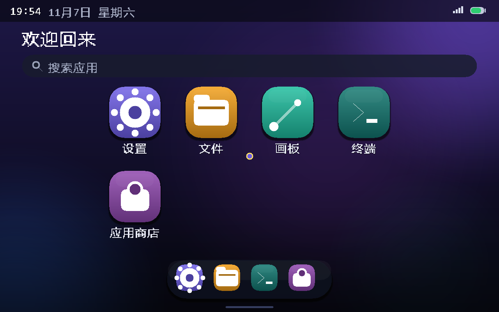
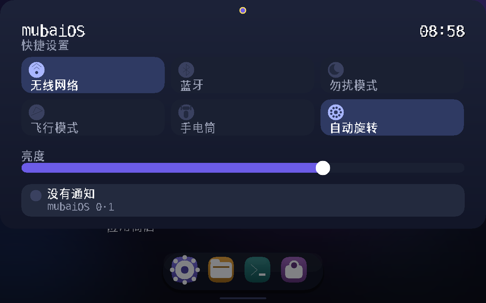
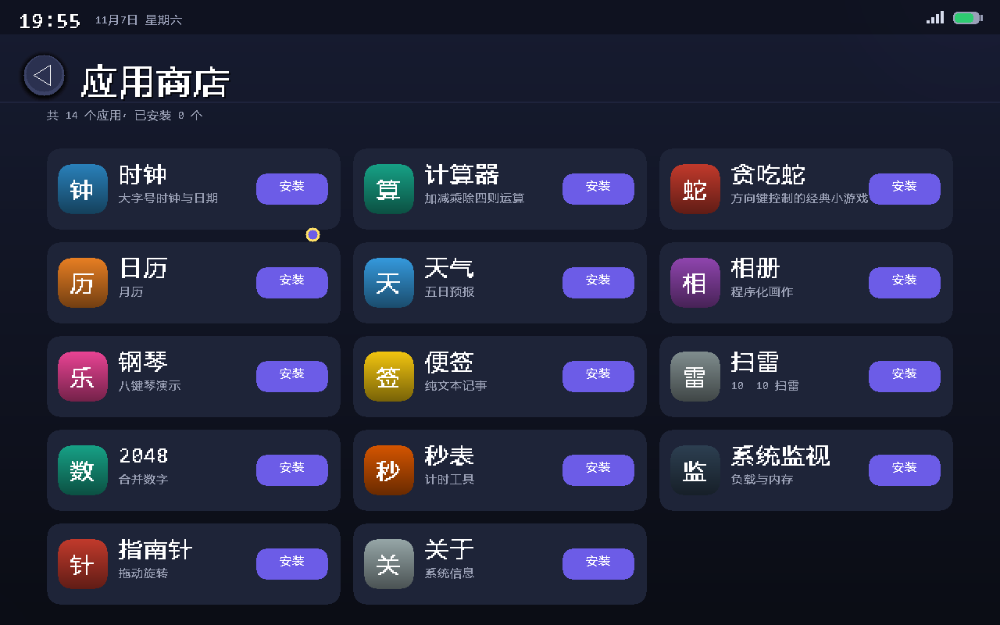
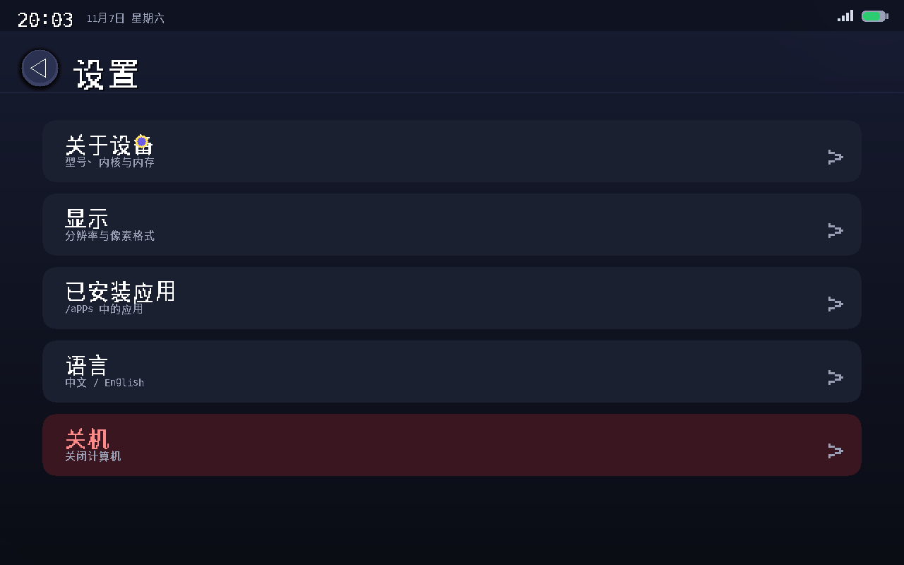
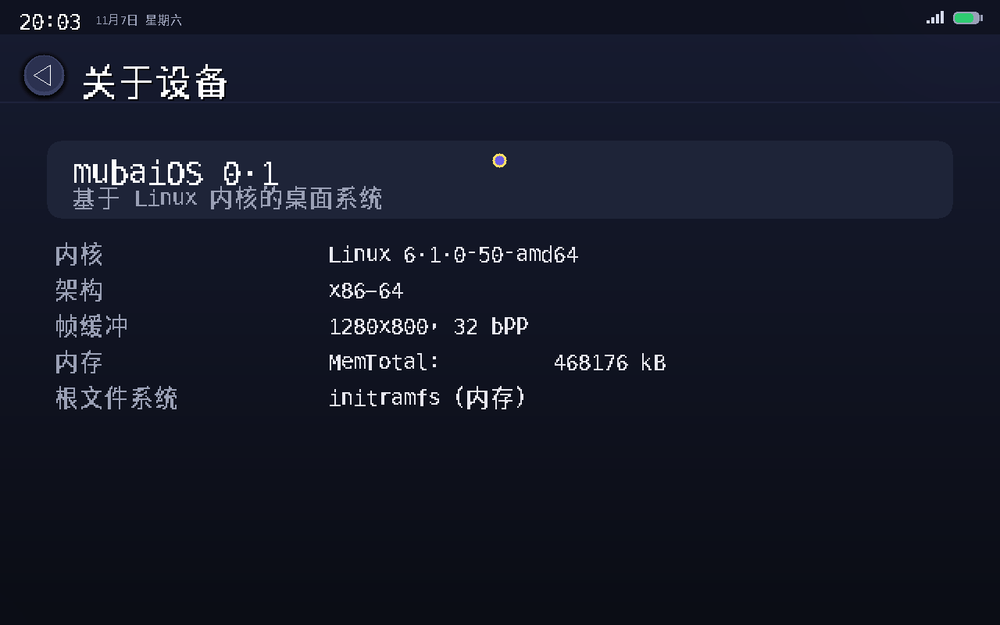
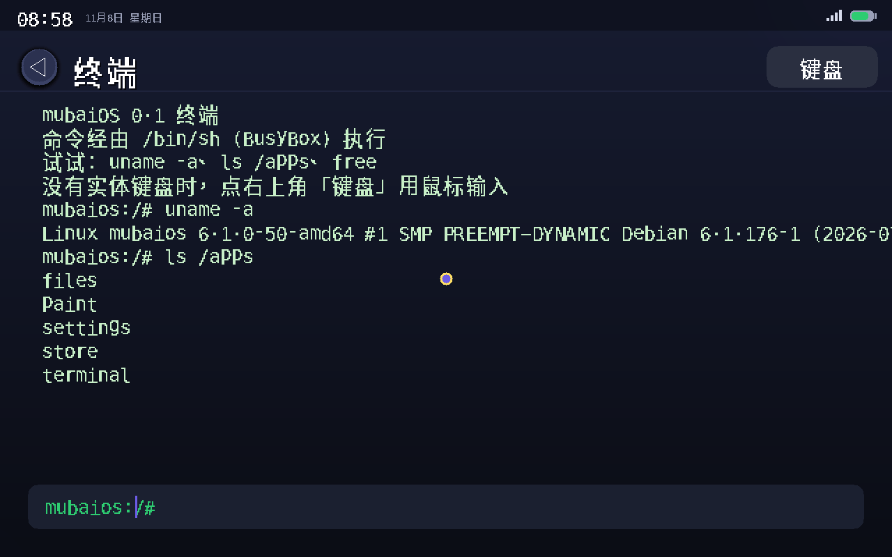

# mubaiOS

一个**从零写起**的桌面系统：自己实现 PID 1、系统服务、图形栈和应用 SDK，跑在 Linux 内核上。
界面直接写 `/dev/fb0`，不用 X11、不用 Qt/GTK、不用任何 GUI 框架；应用是静态链接的 ELF，放进 `/apps` 就能运行。

- 版本：0.1（x86-64）
- 内核：Linux 6.1（Debian `6.1.0-50-amd64`）
- 镜像：`out/mubaios-0.1-x86_64.iso`（**14.6 MiB**，BIOS/CSM 直接引导）
- 许可：**MIT**（自研部分），第三方组件见 [THIRD_PARTY.md](THIRD_PARTY.md)

## 界面

| 桌面 | 快捷设置 | 应用商店 |
| --- | --- | --- |
|  |  |  |

| 设置 | 关于设备 | 终端 |
| --- | --- | --- |
|  |  |  |

## 特性

- **自研用户态**：`init`（PID 1）挂载文件系统、按依赖顺序加载内核模块、启动服务、回收子进程、断电关机。
- **直接帧缓冲**：1280×800×32bpp 双缓冲 + 脏矩形刷新，整屏重绘 35 ms，时钟刷新 0.9 ms。
- **自研图形 SDK**（`src/nova.c`，约 900 行）：圆角矩形、渐变、阴影、发光、squircle 图标、UTF-8 位图字体（ASCII + 2671 个汉字）、软件光标、输入事件分发。
- **窗口即进程**：每个应用是全屏进程，`system_server` 负责启动/等待/回归，`/apps/<id>/manifest` 描述名称、图标、颜色、排序。
- **桌面式外壳**：状态栏、搜索框、图标网格、停靠栏、下拉快捷设置、滚动、语言切换（中文/英文）。
- **应用商店**：14 个应用一键安装到 `/apps`，装完立刻出现在桌面。
- **终端**：内置 BusyBox shell，能直接跑 Linux 程序（静态或带 glibc 运行时）。
- **中文输入**：便签内置拼音输入法（GB2312 一级字库 + 词组），本地生成，不依赖云端。

## 下载

- 直接跑：从 [Releases](https://github.com/krclouds/mubaios/releases/tag/v0.1) 下载 mubaiOS-0.1-x86_64.iso（14.6 MiB），
  或自己从源码构建（见下）。
- 启动：qemu-system-x86_64 -m 1024 -smp 4 -cdrom mubaiOS-0.1-x86_64.iso
  （也支持烧到 U 盘、在 Legacy/CSM 模式引导）。

## 快速开始

```bash
# 1. 取开源字体（DejaVu Sans Mono + Noto Sans CJK SC，均可再分发）
python tools/fetch_fonts.py

# 2. 构建 initramfs（会解包内核、编译全部 C 源码、生成字库）
python build.py

# 3. 打包可启动 ISO
python build_iso.py

# 4. 在 QEMU 里跑（Windows）
powershell -File run.ps1
```

启动参数（`run.ps1` 已包含）：

```
-kernel out/mubaios.bzImage -initrd out/mubaios-initramfs.cpio.gz
-append "console=ttyS0 rdinit=/init loglevel=3 vt.global_cursor_default=0"
-vga std -usb -device usb-tablet -accel whpx
```

构建依赖：Python 3.9+、Zig 0.13（`zig cc` 交叉编译到 `x86_64-linux-musl`）、`pycdlib`（打 ISO）、QEMU（运行/测试）。

## 目录结构

```
nova/
├─ src/            全部 C 源码（内核之外的一切）
│  ├─ init.c           PID 1
│  ├─ system_server.c  桌面外壳（状态栏/搜索/网格/停靠栏/快捷设置）
│  ├─ nova.c/.h        图形与输入 SDK
│  ├─ store.c          应用商店
│  ├─ terminal.c       终端（BusyBox shell + 软键盘）
│  ├─ notes.c          便签（拼音输入法）
│  ├─ inputd.c         uinput 虚拟触摸屏服务
│  └─ settings/files/paint/...  其余应用
├─ rootfs/         会打进 initramfs 的文件（BusyBox、glibc 运行时、脚本）
├─ tools/          构建与测试工具（字库生成、截图、QEMU 驱动）
├─ build.py        主构建：内核 + 模块 + initramfs
├─ build_iso.py    生成 BIOS 可引导 ISO
├─ APPS.md         应用手册（每个应用的界面、按键、数据）
└─ THIRD_PARTY.md  第三方组件与许可证
```

## 应用

内置 5 个：设置、文件、画板、终端、应用商店。
商店里另有 14 个：时钟、计算器、日历、天气、相册、钢琴、便签、贪吃蛇、2048、扫雷、秒表、系统监视、指南针、关于。
每个应用的界面布局、按键、数据文件都写在 [APPS.md](APPS.md)。

应用格式（两种都支持）：

```
/apps/<id>/<id>        静态 ELF（musl 或带 glibc 运行时），或一个 shell 脚本
/apps/<id>/manifest    name=显示名 / icon=单字图标 / color=主题色 / order=排序
```

## 开源与许可

- **自研代码**（`src/`、`tools/`、`build.py`、`build_iso.py`、`rootfs/` 脚本）：**MIT**，见 [LICENSE](LICENSE)。
- **第三方组件**：Linux 内核与模块（GPL-2.0）、BusyBox（GPL-2.0）、glibc 运行时（LGPL-2.1）、libgcc（GPL + 例外）、DejaVu Sans Mono（Bitstream Vera）、Noto Sans CJK SC（OFL-1.1）、Unihan 数据（Unicode License）。
  逐项说明、版权归属与源码获取方式见 [THIRD_PARTY.md](THIRD_PARTY.md)。
- **不含闭源第三方内容**：仓库里没有 Minecraft、迷你世界或任何商业游戏的代码/资源，也没有它们的安装包。
  系统本身只依赖上面列出的开源组件。
- 运行期可选下载的东西（Debian 包：X11/Mesa/Wine、`bsdgames` 等）不在仓库里，脚本只负责按需从镜像站拉取，各自遵循其原始许可证。

## 已知限制

- 仅 x86-64 + BIOS/CSM 引导，不支持 UEFI。
- 无虚拟内存换页、无多用户权限模型（所有进程都是 root）。
- 无 GPU 加速：3D 场景（如果额外装 X11/Mesa）走 llvmpipe 软件渲染。
- 应用安装写入内存文件系统，重启后恢复出厂状态（数据盘 `/data` 上的内容会保留）。
